# SnapSort


**Your screenshots, sorted.** A Flutter app for Android that reads your phone's
Screenshots folder and organizes it. No AI and no internet permission:
everything stays on the phone.

<p>
  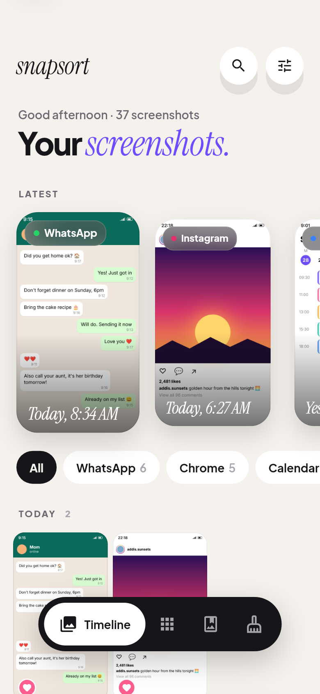
  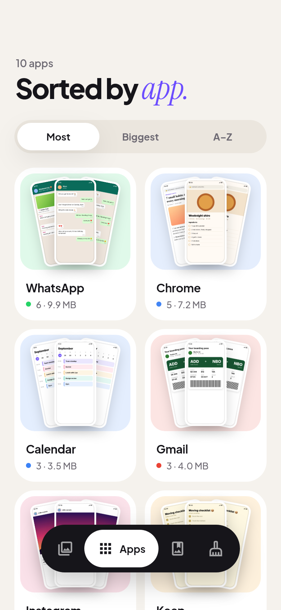
  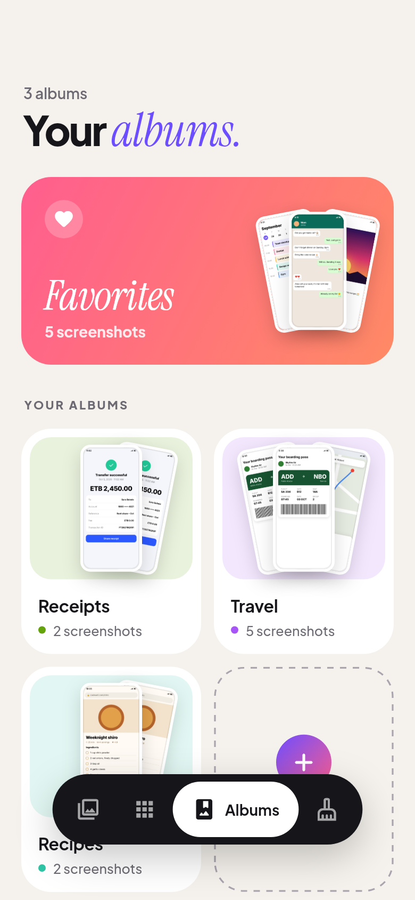
  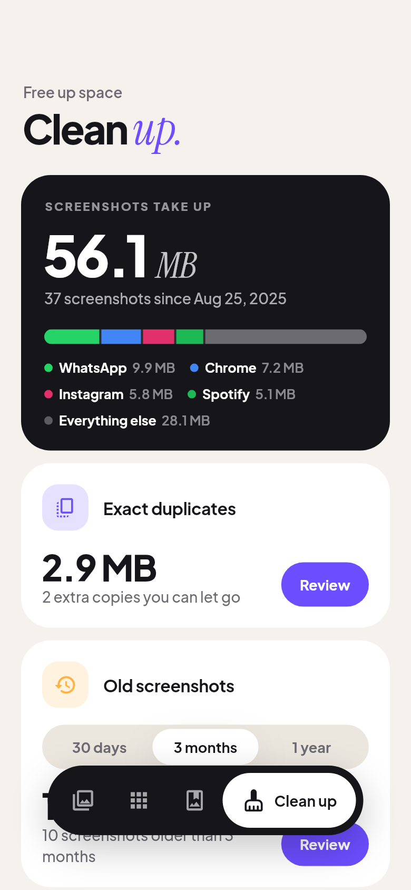
</p>

<p>
  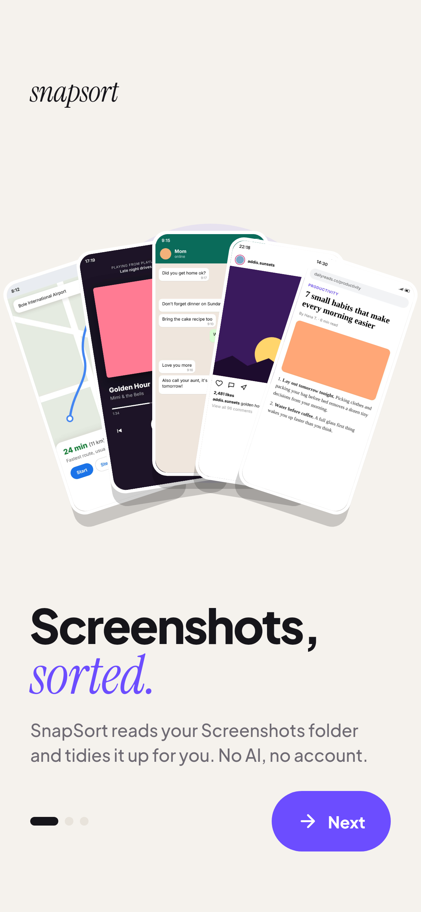
  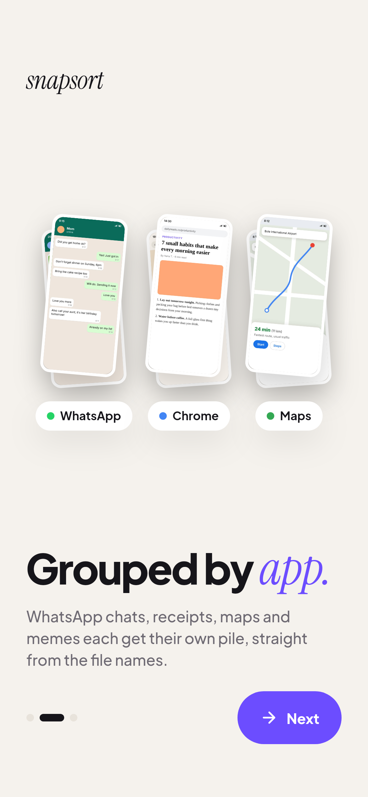
  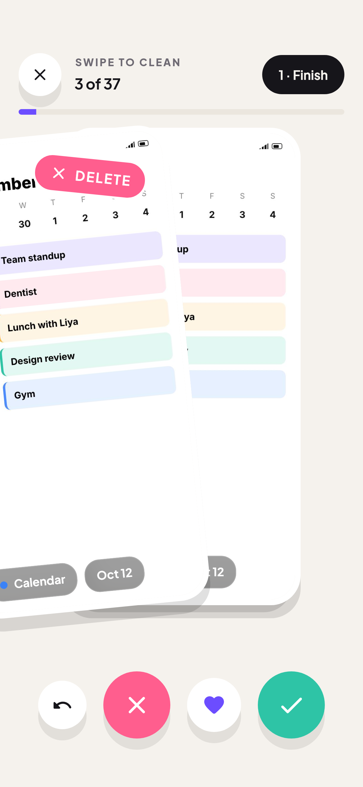
  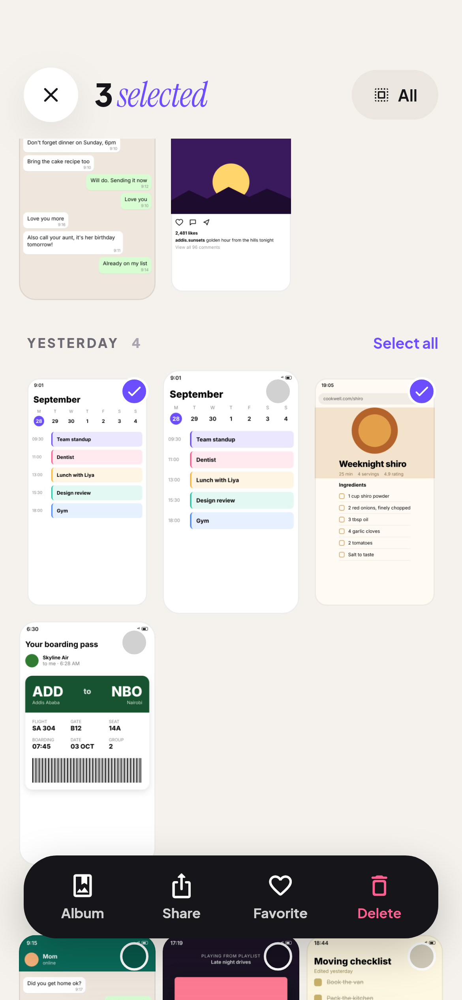
  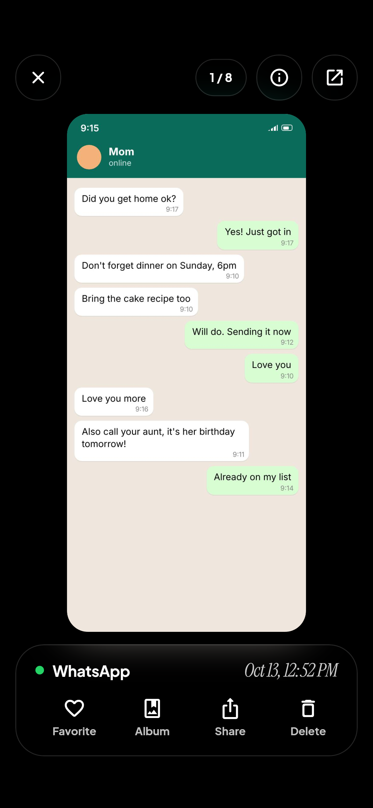
  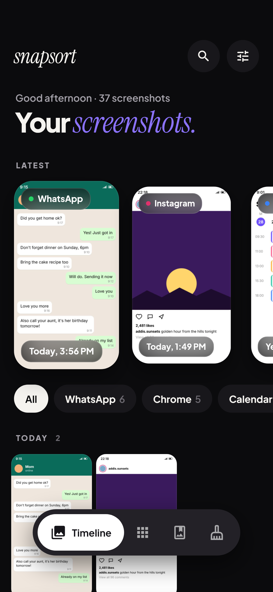
</p>

## Design

A warm, editorial look that matches the app icon.

- **Type:** Plus Jakarta Sans for the interface, with Instrument Serif italic for
  the accent word in each big title ("Your *screenshots.*", "Clean *up.*").
  Both are bundled in `assets/fonts` under the SIL Open Font License.
- **Colour:** a warm off-white page (near-black in dark mode), violet and coral
  from the icon, and a stable colour per app (WhatsApp green, Chrome blue…).
  Flat colours only: no gradients and no emoji anywhere.
- **Shapes:** very rounded cards, white circle buttons, and fanned stacks of
  screenshots, the icon's motif, on every app and album card.
- **Navigation:** a floating dark pill. The current tab grows into a labelled
  white pill. While you select screenshots, it slides away for a dock with
  Album, Share, Favorite and Delete.
- **Viewer:** the thumbnail flies into a full-screen view with frosted-glass
  controls. Pinch or double-tap to zoom, swipe sideways for the next one, swipe
  down to close.
- **Motion:** staggered entrances (`flutter_animate`), springy press feedback,
  numbers that count up, and haptics on selection.
- **Onboarding:** three full-bleed pages with animated art built from sample
  screenshots, ending with the photo permission request.

Design tokens live in `lib/ui/design/tokens.dart` and the theme in
`lib/ui/design/theme.dart`. Light, dark or system theme is set in Settings
(the slider button on the Timeline).

## Features

- **Timeline:** a "Latest" rail of big cards, filter pills for your top apps,
  search (app, file name or month), and a grid grouped into Today / Yesterday /
  This week / months.
- **Apps:** screenshots grouped by the app they were taken in, sorted by most,
  biggest or A–Z. The app is read from the file name, which phone makers fill in
  differently:
  - Samsung / Pixel: `Screenshot_20240115-093012_WhatsApp.jpg`
  - Xiaomi: `Screenshot_2024-01-15-09-30-12-345_com.whatsapp.jpg` (the package
    name, turned into the app's real name)
  - Oppo / OnePlus: `Screenshot_…_<md5 of package>.jpg` (matched against
    installed apps)
  - or a `Screenshots/<App>/` subfolder
- **Albums:** Favorites plus your own albums. Long-press screenshots to select
  them, then add them to an album, share or delete. Long-press an album to
  rename or delete it.
- **Swipe to clean:** go through screenshots one card at a time, Tinder style:
  swipe left to delete, right to keep, up to favorite, with undo. Deletions are
  collected and done together at the end, after a summary, so Android asks only
  once. Kept screenshots are remembered, so the next session picks up where you
  left off. Start it from Clean up, or from any app's page to sweep through just
  that app.
- **Clean up:** how much space screenshots take, split by app; an exact
  duplicate finder that keeps the oldest copy; old screenshots (30 days,
  3 months or 1 year); and the biggest files. On Android 11+ deletes go to the
  system recycle bin, where they can be restored for 30 days.

## Run

```sh
flutter pub get
flutter run                          # on a phone
flutter run --dart-define=DEMO=true  # filled with sample screenshots (nothing is read or deleted)
flutter test
flutter build apk --release --target-platform android-arm,android-arm64   # one APK for every phone
```

The screenshots above are rendered from the real screens with demo data:

```sh
flutter test --dart-define=SCREENSHOTS=true test/screenshots_test.dart
```

Release builds are signed with the key in `android/key.properties` (not
committed). Without it they fall back to the debug key.
`scripts/setup-signing.sh` recreates it from the `ANDROID_KEYSTORE_*` secrets.

## Releases

Push a tag that matches the version in `pubspec.yaml` (for example `v1.2.0`), or
run Actions > Release > Run workflow. It runs the checks, builds the signed APK,
verifies the signing key's fingerprint and publishes the Release with the APK
and a checksum. It needs the repository secrets `ANDROID_KEYSTORE_BASE64`,
`ANDROID_KEYSTORE_PASSWORD` and `ANDROID_KEY_ALIAS`.

## Banners

<p>
  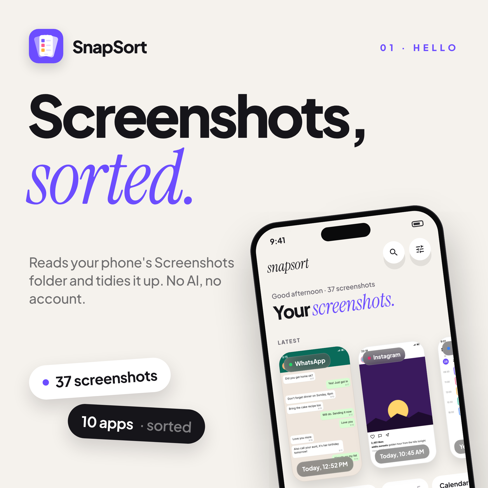
  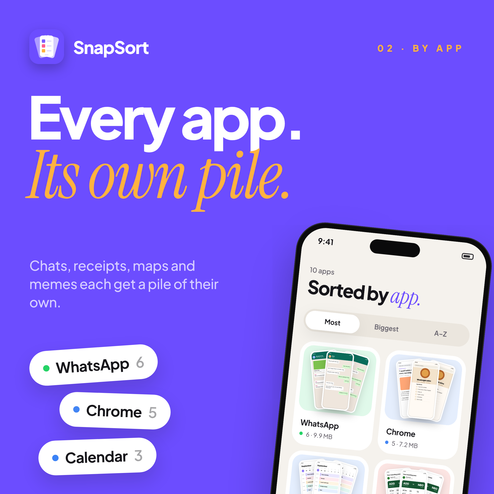
  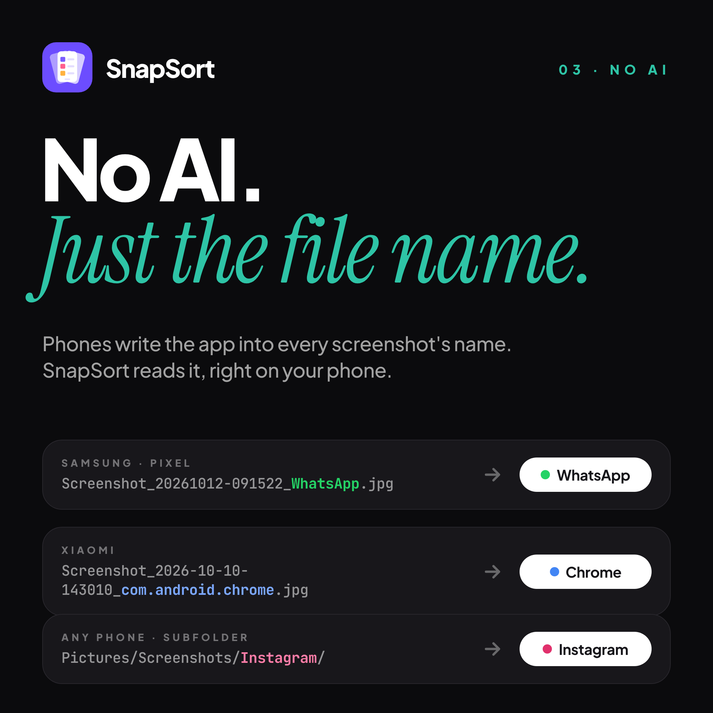
  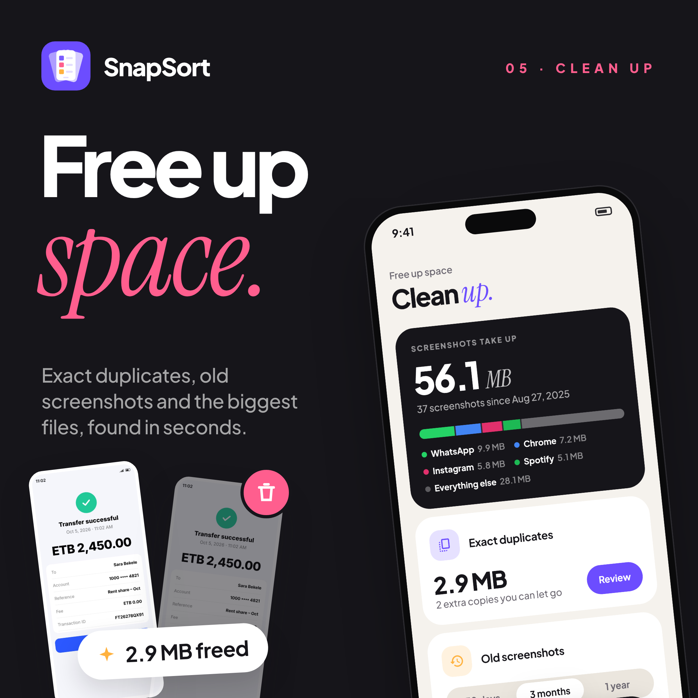
</p>

Eight 2160 × 2160 banners in `docs/banners`, built from `tool/banners/banners.html`
around real renders of the app:

```sh
flutter test --dart-define=SCREENSHOTS=true test/screenshots_test.dart   # app screens
node tool/banners/render.cjs                                              # needs `playwright`
```

The sample screenshots used in demo mode, onboarding and the banners come from
`node tool/demo/render.cjs`.

## Icon

The launcher icon is drawn in code by `design/icon/gen_icon.py` (Android vector
drawables plus `icon.svg`); `node design/icon/render.cjs` renders the PNGs, then
`dart run flutter_native_splash:create` regenerates the launch screen.

## Structure

```
lib/
  app/        prefs (theme), routes
  data/       Shot model, Library state, file-name → app parser, native channel, demo data
  ui/design/  tokens and theme
  ui/widgets/ pressable, glass, pills, cards, shot tiles, floating nav, selection dock
  ui/screens/ shell, timeline, apps, albums, clean up, group page, viewer, settings
  ui/onboarding/
android/…/MainActivity.kt   MediaStore query, recycle bin, share, app names, hashing
```
